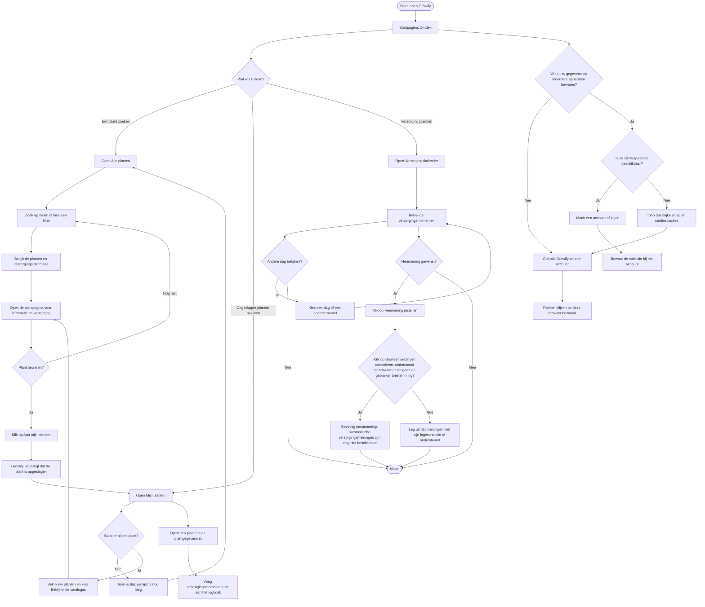

# Gebruikersflow van Growify

De hoofdroute is bewust eenvoudig: bezoekers kunnen eerst rustig rondkijken, hoeven geen account te maken en krijgen na belangrijke acties duidelijke bevestiging.

## Aandacht voor oudere of minder digitaal vaardige gebruikers

- Gebruik korte, gewone woorden en één duidelijke actie per knop.
- Maak knoppen en klikbare dagen groot genoeg en geef ze voldoende ruimte.
- Toon na opslaan, verwijderen of instellen direct een begrijpelijke bevestiging.
- Maak een account optioneel; laat bezoekers eerst planten ontdekken en bewaren.
- Leg fouten uit in gewone taal en geef meteen de volgende stap.
- Gebruik naast kleur ook tekst, pictogrammen of markeringen om informatie duidelijk te maken.
- Houd de hoofdnavigatie op elke pagina op dezelfde plek en gebruik overal dezelfde paginanamen.
- Browsertoestemming is geen geplande herinnering: automatische verzorgingsmeldingen zijn nog niet beschikbaar.
